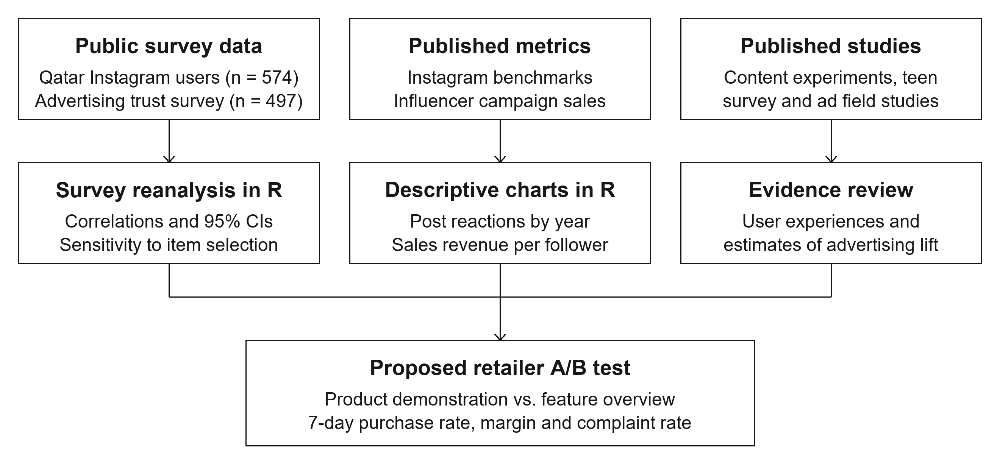
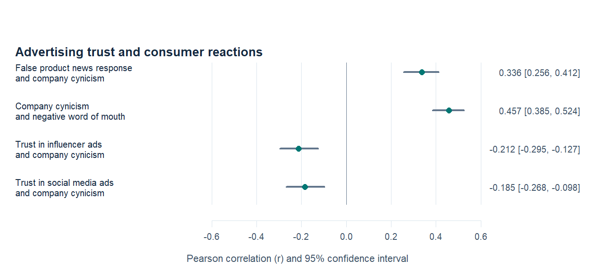
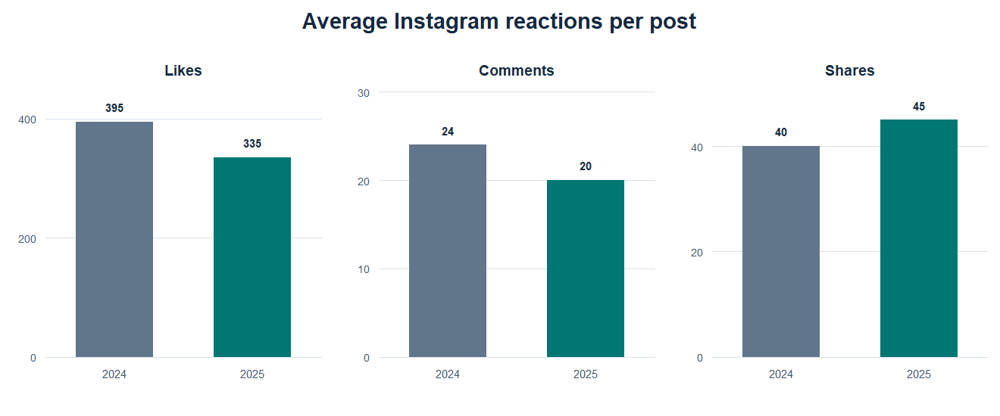
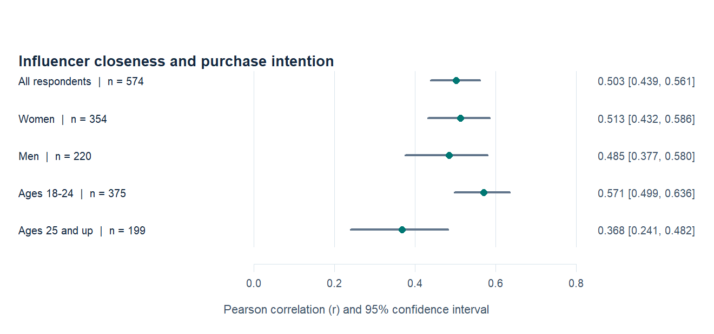
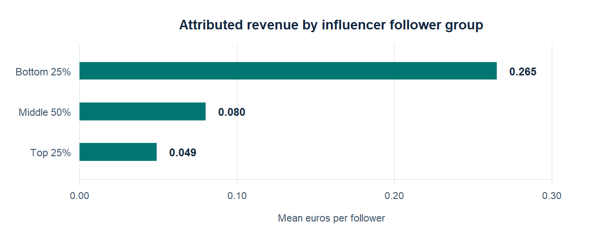

# Digital Business and E-Commerce



*Research design and evidence flow.*

**What can a social media post tell an online store about its next sale?**

An English-language research portfolio adapted from an academic chapter on social media content and e-commerce. It brings together two survey reanalyses in R, published platform benchmarks, sales evidence, and a test design that a retailer could use to measure its own results.

## Findings at a glance

| Question | Result | Evidence |
| --- | --- | --- |
| Do people who feel closer to an influencer report stronger purchase intentions? | **Yes, within this sample.** The correlation was **0.503** among 574 Instagram users in Qatar. | R reanalysis of a 2020 survey |
| Do advertising trust and consumer cynicism move together? | Greater trust in influencer ads was associated with slightly lower cynicism about companies. **r = −0.212**, n = 497. | R reanalysis of a separate consumer survey |
| Did Instagram engagement move in one direction from 2024 to 2025? | Average likes fell from **395 to 335**, comments fell from **24 to 20**, and shares rose from **40 to 45**. | Socialinsider annual tables |
| How did smaller creators perform in a fashion campaign sample? | The bottom quarter by follower count averaged **€0.265** in attributed revenue per follower. The top quarter averaged **€0.049**. | Beichert et al. (2024), Table 2 |

[Study sources](SOURCES.md) · [Statistical methods](METHODS.md) · [Data and downloads](data/README.md) · [R code](analysis/reproduce.R) · [Result tables](results/)

## 1. What content does for the people who see it

Content can affect what people learn and how they feel. In a randomized field experiment with 3,395 adults in France and Germany, following credible news accounts for about two weeks improved factual knowledge and the ability to distinguish true claims from false ones. In a separate experiment with 273 women aged 18–28, brief exposure to TikTok videos promoting extreme thinness reduced immediate body satisfaction more than neutral videos did. The studies tested specific types of content and measured different outcomes. [Altay et al. (2025)](https://doi.org/10.1038/s41562-025-02205-6) · [Blackburn and Hogg (2024)](https://doi.org/10.1371/journal.pone.0307597)

Pew’s 2025 survey of 1,458 US teens offers a broader view. Among the 908 Instagram users in the sample, **10%** said the content they see makes them feel better about themselves, **3%** worse, **25%** an equal mix of both, and **62%** said it makes no difference. These are weighted self-reports about how users feel. [Pew Research Center (2026)](https://www.pewresearch.org/internet/2026/04/15/teens-experiences-on-tiktok-instagram-and-snapchat/) · [Survey topline, p. 9](https://www.pewresearch.org/wp-content/uploads/sites/20/2026/04/PI_2026.04.15_Teens-Cross-Platforms_TOPLINE.pdf)

### Advertising trust and consumer reactions

In 497 public survey responses from adults aged 18–34, respondents who scored higher on trust in influencer advertising tended to score lower on cynicism about company motives. That link was modest (**r = −0.212**, 95% CI **−0.295 to −0.127**). Cynicism and negative word of mouth had a stronger positive association (**r = 0.457**). The survey captures how responses vary together and leaves open which factors drive them. [Moisescu et al. (2026)](https://doi.org/10.1016/j.chb.2025.108842) · [Recomputed estimates](results/advertising_trust_correlations.csv)



## 2. What views, likes, comments and shares measure

A view records exposure under the platform’s rules. Retention shows where viewers keep watching or drop off. Likes, comments, and shares capture distinct actions. Read each metric alongside its denominator and time window. A post can earn fewer likes and still be shared more often. [YouTube audience-retention documentation](https://support.google.com/youtube/answer/9314415?hl=en) · [Socialinsider benchmarks](https://www.socialinsider.io/social-media-benchmarks)



The chart uses published full-year averages from Socialinsider’s multi-platform benchmark. Each panel has its own scale so the values remain legible. Instagram’s reporting shift from impressions to views in 2025 complicates year-to-year comparisons of exposure. [Source tables and methodology](https://www.socialinsider.io/social-media-benchmarks) · [Chart data](data/instagram_reactions.csv)

For a store, the measurement sequence is **content exposure → product-page visit → completed order**. Tagged links identify visits and campaign codes help attribute purchases. Either is useful for tracking. To estimate how many purchases the campaign added, randomly assign eligible users to a campaign group and a holdout group. Gordon et al. found that observational methods often disagreed with randomized estimates across 15 Facebook advertising experiments. [Gordon et al. (2019)](https://doi.org/10.1287/mksc.2018.1135)

## 3. Influencer closeness and purchase intention

Researchers collected 574 valid responses from Instagram users in Qatar in winter 2020 through a survey shared through participants’ networks. This portfolio reuses that dataset. **Parasocial closeness** means the one-sided sense of connection a follower can feel with a creator. The analysis averages four closeness items and five purchase-intention items, all scored from 1 to 5. [AlSulaiti and Ben Mimoun dataset (2023)](https://doi.org/10.17632/zv6fdn2ysv.3) · [Data article](https://doi.org/10.1016/j.dib.2024.110128)

| Scale | Items | Mean out of 5 | Cronbach’s α |
| --- | ---: | ---: | ---: |
| Parasocial closeness | 4 | 3.39 | 0.842 |
| Purchase intention | 5 | 3.06 | 0.896 |

The overall **Pearson correlation was 0.503** (95% CI **0.439 to 0.561**). When the item that also touches on satisfaction was dropped, the correlation fell to **0.441**. People who felt closer to a creator still tended to report stronger purchase intentions. The outcome was what respondents said about buying. The study design provides neither transaction records nor a representative estimate for Qatar or Azerbaijan. [Scale statistics](results/qatar_scale_statistics.csv) · [Sensitivity results](results/qatar_sensitivity.csv)



Each point marks a correlation and each line its 95% interval. The age and gender estimates are exploratory. They describe these subgroups and should not guide demographic targeting on their own. [Correlation table](results/qatar_correlations.csv) · [Statistical methods](METHODS.md)

## 4. From creator engagement to a retail decision

Beichert et al. analyzed **2,808 sponsored Instagram posts** from **1,698 influencers** associated with a European fashion retailer from 2018 to 2021. Smaller creators averaged more **code-attributed revenue per follower** in that sample. The groups are based on relative follower counts within the study. Campaign-code sales may include customers who would have bought anyway. The authors’ separate return-on-spend measure uses estimated endorsement costs, and the figures below report gross sales revenue per follower. [Beichert et al. (2024), Table 2](https://journals.sagepub.com/doi/10.1177/00222429231217471)



### A test an online retailer could run

Compare two videos for the same product. **A** explains the features and **B** shows how the product is used. Keep the product, price, placement, audience, video length, and budget comparable. Randomly assign eligible users 1:1 and decide in advance what purchase-rate change would justify switching formats.

| Measure | How to calculate it |
| --- | --- |
| Primary outcome | Users with a completed purchase within seven days ÷ all users assigned to that version × 100 |
| Difference | Version B purchase rate minus version A purchase rate, in percentage points, with a 95% confidence interval |
| Commercial outcome | Margin after product costs and campaign costs, compared per assigned user |
| Customer guardrail | Complaint rate per assigned user over the same measured period |

Plan sample size from the baseline purchase rate and the smallest worthwhile change. Start with two full weeks of assignment to cover each day of the week twice, extend if the planned sample requires it, and allow seven days of follow-up for the final cohort. This design estimates which creative performs better under the campaign conditions. Measuring the lift from running the campaign itself requires a separate no-campaign holdout. [Microsoft Research experiment design](https://www.microsoft.com/en-us/research/articles/patterns-of-trustworthy-experimentation-pre-experiment-stage/) · [Gordon et al. (2019)](https://doi.org/10.1287/mksc.2018.1135)

Show how the product works, including material limitations. Disclose sponsorship clearly and verify product claims before publishing them. Product demonstrations, creator choice, and disclosure should each be evaluated against the business and customer outcomes they are meant to improve. [Pan et al. (2025)](https://doi.org/10.1007/s11747-024-01052-7) · [Eisend et al. (2020)](https://doi.org/10.1080/00913367.2020.1765909) · [Barari et al. (2026)](https://doi.org/10.1007/s11747-025-01107-3)

## Reproduce the analysis

Download the two original CSVs using the [data guide](data/README.md), save them under `data/raw/`, then run this command from the repository root. The script uses base R and writes five aggregate tables and four figures. The source data guides explain which inputs come from surveys and which are transcribed benchmarks.

```bash
Rscript analysis/reproduce.R
```

**Project scope.** This portfolio adapts a chapter from the *Digital Business and E-Commerce* academic material. Codex assisted with English editing, code packaging, and verification. Primary studies and their data are credited to their authors. [Complete references](SOURCES.md)
